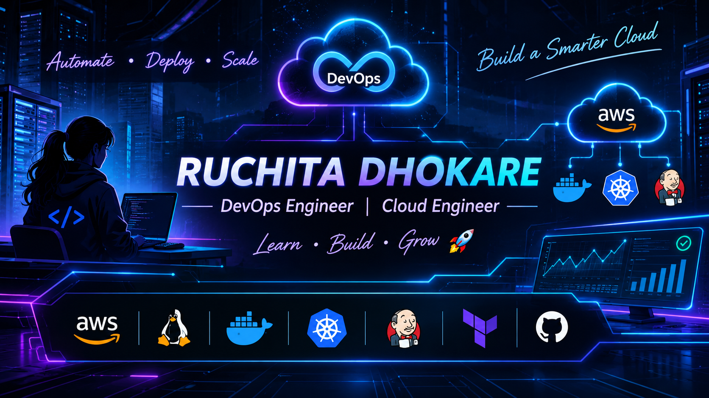

  

## ✦ ABOUT ME

Hello! I'm Ruchita, an MCA student interested in Cloud Computing and DevOps Engineering.

- ☁️ Exploring AWS Cloud Services
- ⚙️ Working with DevOps tools and automation
- 🐧 Familiar with Linux Administration
- 🚀 Interested in CI/CD and Infrastructure as Code
- 📚 Continuously learning new technologies

---

## ✦ TECH STACK

### ☁️ Cloud Platform

**AWS Services**

`EC2` `S3` `IAM` `VPC` `EBS` `RDS` `CloudWatch` `CloudFront` `Route 53` `ASG` `ELB` `NAT Gateway` `Security Groups`

### 🐧 Operating System & Scripting

`Linux` `Ubuntu` `Bash Scripting` `SSH` `User Management` `Permissions`

### 🐳 Containerization & Orchestration

`Docker` `Docker Compose` `Images` `Containers` `Kubernetes` `Pods` `Deployments` `Services`

### ⚙️ CI/CD & Automation

`Jenkins` `Jenkins Pipeline` `Jenkinsfile` `GitHub Actions` `Webhooks` `CI/CD`

### 🏗️ Infrastructure as Code

`Terraform` `Providers` `Resources` `Variables` `Modules` `State Management`

### 📊 Monitoring & Logging

`AWS CloudWatch` `Datadog` `Metrics` `Logs` `Dashboards` `Alerts`

### 🌐 Networking & Web Servers

`TCP/IP` `DNS` `HTTP/HTTPS` `Nginx` `Reverse Proxy` `SSL/TLS` `PM2`

### 🔧 Version Control

`Git` `GitHub` `Branching` `Merging` `Pull Requests`

---

## ✦ GITHUB ANALYTICS

---

## ✦ LET'S CONNECT

---

## 🐍 CONTRIBUTION SNAKE

**✨ Thanks for visiting my profile!**

